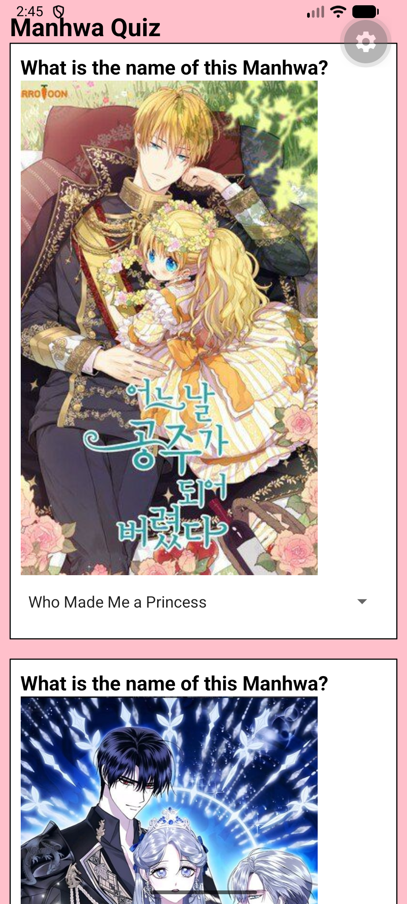
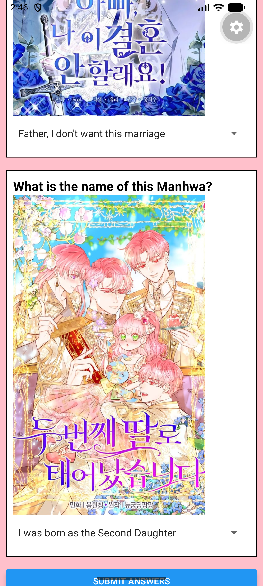
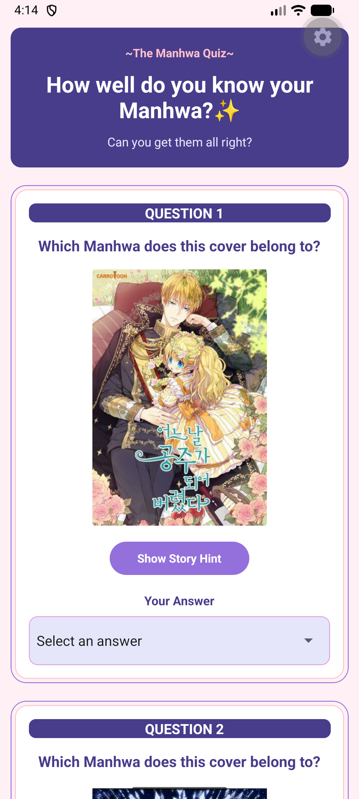
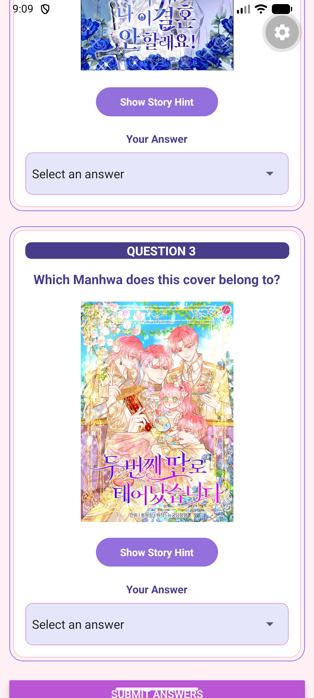

# The Manhwa Quiz

A brief description of the mobile application and its purpose.  

The Manhwa Quiz allows users to test their knowledge on popular manhwa by showing
its cover images and letting them choose the correct titles from the dropdown options.
Users can also view story hints to help them answer the three questions. After submitting their answers,
they will receive a score out of 3.

# ScreenShots of App BEFORE applying Stylesheet changes

Screenshots:  
top picture:

bottom picture:

# ScreenShots of App AFTER applying Stylesheet changes

Screenshots:  
top picture:

bottom picture:

# Link to Demo Video with audible narration explaining styling changes with code reference

Demo Video Link:  
https://drive.google.com/file/d/1uOLQo_REBIJB_fGyz-jUBeATJfcRDzl-/view?usp=sharing

